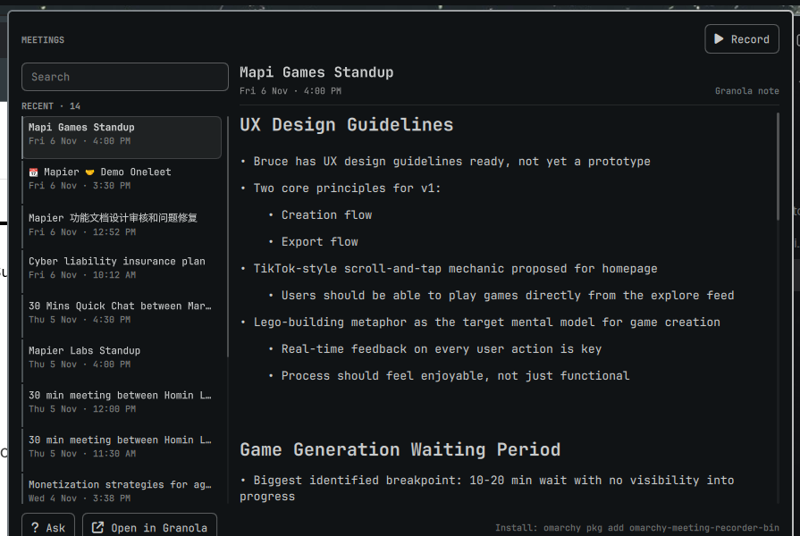
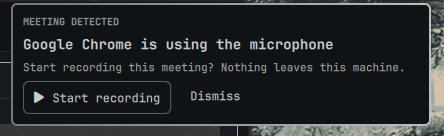
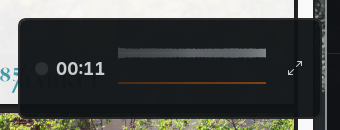

# Omarchy Granola Widget

Granola-shaped meeting notes in the [Omarchy](https://omarchy.org) bar: a notes
panel, meeting detection, and — when Granola's desktop app is installed —
Granola's own transcription and summaries on Linux. A local recorder remains as
a fallback.



It is a thin layer over [jankeesvw/omarchy-meeting-recorder](https://github.com/jankeesvw/omarchy-meeting-recorder),
which already records your microphone and the computer audio as two tracks,
transcribes them locally, and separates the speakers. This project adds the
Granola-shaped parts:

- **A notes panel** — recent meetings on the left, the note or transcript on
  the right, search, and record/pause/stop in the header.
- **Enhanced notes** — an automatic recorder action that turns the transcript
  (plus anything you typed during the call) into a summary, key points,
  decisions, action items and open questions, written with your default agent.
- **Ask about a meeting** — a question box that answers from the selected
  meeting's note and transcript.
- **Meeting detection** — when another app opens the microphone (Meet, Zoom,
  Teams, Webex, Slack, Discord), a small popup offers **Start recording**.
  No calendar, no account, no setup.
- **Granola notes** — connect once with Granola's official MCP OAuth and the
  same list shows your Granola notes read-only alongside local meetings.

With the local recorder, nothing leaves this machine. With Granola's engine the
audio goes to Granola's transcription service (Deepgram/AssemblyAI) and the note
lives in your Granola account — that is the point of using it. Either way the
plugin only reads Granola's notes through MCP; it never writes into the account.

## Requirements

- Omarchy 4.x (Quickshell, Hyprland, `omarchy-shell`)
- [Meeting Recorder](https://github.com/jankeesvw/omarchy-meeting-recorder):
  `omarchy pkg add omarchy-meeting-recorder-bin`
- A default Omarchy agent for the notes: `omarchy default agent` (OpenCode by
  default)

## Install

```bash
git clone <this-repo> ~/Work/omarchy-granola-widget
cd ~/Work/omarchy-granola-widget
./install.sh
```

The installer:

- symlinks the repo root to `~/.config/omarchy/plugins/markxiong.granola`
- rescans and enables the bar widget on the right
- appends the `Enhanced notes` action to
  `~/.config/omarchy-meeting-recorder/config.toml`
- creates `~/Documents/Meetings`
- creates `~/.config/omarchy-meeting-notes/granola.json` as an empty template
- offers to install Meeting Recorder if it is missing

It never edits your Hyprland keybindings. To open the panel with a key, add to
`~/.config/hypr/bindings.lua`:

```lua
o.bind("SUPER + ALT + M", "Granola", "omarchy-shell shell toggle markxiong.granola")
```

## Meeting detection

The prompt is what makes it feel like Granola: a meeting is starting, so the
plugin asks whether to record.

It needs no calendar and no account. The signal is the useful part of a call:
another application opens the microphone. Joining a Meet, Zoom, Teams, Webex,
Slack or Discord call does exactly that, and the OS already knows. There is no
feed to paste and no OAuth screen.

`bin/meeting-active` reads the PulseAudio capture list and reports the app;
`MeetingDetect.qml` polls it every five seconds, waits for two polls in a row,
then shows the prompt:



- **Start recording** starts Meeting Recorder and closes the card.
- **Dismiss** leaves that app alone until it releases the microphone and opens
  it again.
- The card stays hidden while a recording is already running, and the recorder's
  own capture is ignored, so it cannot prompt itself.

Detection is deliberately conservative: it fires while a call is actually using
the mic, so it asks after you join rather than before, and it stays quiet if you
listen without a microphone. That is the trade for zero setup. Check the signal
directly with:

```bash
bin/meeting-active
# {"active": true, "label": "Google Chrome", "binary": "chrome"}
```

The panel's **Record** button is still there for a meeting that detection
misses.

Granola's own calendar connection is internal to Granola: the MCP server has no
calendar tool, and the plugin never sees those events. Detection is local
instead, so it works with any meeting app, calendar or not.

### The recording chip

Starting a recording leaves only a chip on screen, not the full app window. The
recorder floats (install.sh adds the Hyprland rule) and
`bin/start-recording` shrinks it to its compact strip once the recording is
running: a red dot, the clock, both waves and an expand button.



Drag it anywhere; the expand button or Ctrl+M brings the full window back. On
stop the app expands to its transcribing page, the same as when you start from
the recorder itself.

Without the Hyprland rule the window still shrinks, but it tiles. The rule is:

```lua
o.window({ class = "^com\\.jankeesvw\\.OmarchyMeetingRecorder$" }, { float = true })
o.window({ class = "^com\\.jankeesvw\\.OmarchyMeetingRecorder$" }, { center = true })
```

## Running Granola itself (optional)

The plugin reads Granola notes through MCP, but Granola's own transcription
and summary need Granola's desktop client, which does not ship for Linux. The
plugin can build the official client on x86-64 Linux:

```bash
bin/granola-linux            # pinned version, downloaded and built
bin/granola-linux --check    # is it installed?
```

It extracts the official macOS DMG, swaps in the matching official Linux
Electron runtime, rewrites the platform string Granola's API rejects
(`platform=linux` returns HTTP 500), and rebuilds Granola's encrypted SQLite
module for Linux. No Wine, no VM. Sign in once; the plugin's MCP connection
keeps working independently.

The build is pinned to **7.726.2** because newer bundles (7.749+) ship only the
prebuilt Mach-O SQLite module, with no C++ source to rebuild. `--version X`
and `--latest` are available, with that caveat. It installs under
`~/.local/share/omarchy-meeting-notes/granola`, with a `granola` launcher in
`~/.local/bin` and a `granola://` handler.

Two caveats: the repackage is unofficial and can break when Granola changes its
bundle, and **system audio is the part to test**. Microphone capture is
PipeWire; the other side of the call uses Granola's Linux loopback path. Start a
note, play something, and check the transcript before trusting it with a real
meeting. If the loopback misses it, route a mic + monitor mix into Granola as
its input.

### It is the plugin's recorder

When the app is installed, the plugin uses Granola as its recording engine by
default. `bin/granola-engine` launches the app with a debugger port, clicks the
same **New note** button a person would, moves the main window to a
`special:granola` workspace, and leaves only Granola's **Nub** — a 34 px floating
pill with the waves — on screen. The panel's **Record / Stop** drive it:

- **Record** starts a note and hides the main window.
- **Stop** turns capture off; Granola saves and summarizes the note as usual.
- The Nub is the chip; click it to open the note, or run

```bash
bin/granola-engine show    # bring the main window back
bin/granola-engine hide    # move it away again
bin/granola-engine state   # JSON: running, transcribing, id, state
```

It is still Electron, but there is no app window in the way, and every byte of
audio, every transcript and every summary is Granola's. The plugin only
supervises it.

To keep the local recorder instead, put `"engine": "recorder"` in the plugin's
entry in `~/.config/omarchy/shell.json`.

### Granola's calendar, without the app running

The app is already connected to Google Calendar, and its session token is good
for six hours. `bin/granola-engine calendar` calls the same endpoint the app's
"Coming up" section uses, and prints the events as JSON — no app window, no ICS
feed and no Google OAuth client:

```bash
bin/granola-engine calendar --minutes 1440
```

Each event carries `summary`, `start`, `end`, `join_url` (Meet/Zoom/Teams),
`location`, `calendar` and `html_link`. The token is cached in
`~/.cache/omarchy-meeting-notes/granola-token.json` (mode 600); when it expires
the helper launches Granola briefly to refresh it, then quits.

This is a private endpoint (`POST /v1/refresh-calendar-events`), so it can
change with a Granola update; the plugin treats it as best-effort.

## Using the panel

Click the note icon on the right of the bar. The panel has:

- **Record / Stop** in the header, and **Pause** while recording
- recent meetings on the left; type in the search box to search titles, notes
  and transcripts
- the enhanced note on the right, or the transcript while the note is being
  generated
- **Ask** for a question about the selected meeting
- **Open in Recorder** / **Open folder** at the bottom

Keyboard: `↑` `↓` select, `Enter` open the meeting, `/` search, `?` ask,
`r` record/stop, `p` pause/resume, `o` open the folder, `f` refresh,
`Esc` close. In the search or ask box, `Esc` clears or closes it.

Right-clicking the bar icon opens the newest meeting's folder.

When a recording stops, Meeting Recorder transcribes it and then runs the
**Enhanced notes** action. The result is `enhanced.md` next to `transcript.md`.
The panel picks it up automatically; you can also run the action again from
the recorder's Actions menu to regenerate it.

## Connect Granola (read-only)

The panel can merge your existing Granola notes into the list. It uses
Granola's official **MCP** connection, so there is no API key to create and it
works on the Free plan too (the last 30 days of notes; Business/Enterprise
sees full history).

Connect once:

```bash
cd /path/to/omarchy-meeting-notes/bin
./granola-oauth --connect
```

That prints a device URL, opens it in the browser, and waits for you to approve
**“Meeting Notes for Omarchy”**. The token is stored in
`~/.config/omarchy-meeting-notes/granola-oauth.json` (mode 600) and refreshed
automatically.

Check the account it connected to:

```bash
./granola-oauth --status
```

Granola notes appear with a `Granola` label in the list. They are on by
default; set `"granolaSource": false` in the plugin's `shell.json` entry to hide
them:


**Open in Granola** opens the note's web URL. The notes are cached in
`~/.cache/omarchy-meeting-notes/granola` for five minutes. Granola stays
read-only — nothing is written back.

If you have a Granola **Business/Enterprise** API key and prefer the REST API,
put it in `~/.config/omarchy-meeting-notes/granola.json` instead:

```json
{
  "apiKey": "grn_...",
  "apiUrl": "https://public-api.granola.ai"
}
```

The helper uses the API key when present and falls back to the MCP token
otherwise.


## How it works

```
~/Documents/Meetings/202611091030 Design sync/
├── 202611091030 Design sync.meeting-recorder   # title, speakers, chapters
├── transcript.md                               # what Meeting Recorder wrote
├── enhanced.md                                 # what this project adds
├── notes.md                                    # notes written during the call
├── audio.ogg
└── .tracks/
```

- `Panel.qml` is the Quickshell bar widget and popup.
- `MeetingDetect.qml` is a singleton poller and the meeting prompt.
- `bin/meeting-notes-index` turns the meeting folders (and optionally
  Granola) into the JSON the panel lists. It is read-only.
- `bin/meeting-active` reports whether another app is capturing the microphone,
  from `pactl`'s JSON, and which app it is.
- `bin/granola-linux` builds the official Granola desktop payload for Linux
  (platform patch + Electron runtime + SQLite rebuild).
- `bin/granola-engine` drives that app over the DevTools protocol: start, stop,
  state, show and hide; the main window is hidden while the Nub is the chip.
- `bin/start-recording` starts the recorder and leaves only the compact chip.
- `bin/recorder-chip` waits for the recording to start, then shrinks the
  recorder window once, and only if it is still the full one.
- `bin/granola-index` reads Granola through the official MCP connection
  (or a Business API key, when configured) and caches each note as Markdown.
- `bin/granola-oauth` runs the device-code OAuth flow, stores the tokens,
  and refreshes them; `--status` shows the connected account.
- `bin/enhanced-notes` is a Meeting Recorder action. It gets `MEETING_*`
  variables from the recorder, combines `notes.md` (if you typed any) with the
  turn-by-turn transcript, asks `omarchy-meeting-recorder ask` for the note,
  and writes `enhanced.md`.

The action's prompt lives in `bin/enhanced-notes`; edit it if you want a
different shape of note. The default is deliberately strict: it only uses facts
from the transcript, never invents owners or dates, and marks an action
**Unassigned** when the speaker is not clear.

## Configuration

The panel reads meetings from `~/Documents/Meetings` by default. To point it
somewhere else, add `meetingDir` to its entry in `~/.config/omarchy/shell.json`:

```json
{
  "id": "markxiong.granola",
  "meetingDir": "/path/to/meetings",
  "granolaSource": true
}
```

The recorder hot-reloads `~/.config/omarchy-meeting-recorder/config.toml`, so
the action appears without restarting anything. The Granola helper hot-reads its
JSON file on the next poll.

## Notes and limits

- Speaker labels in `enhanced.md` come from Meeting Recorder. Rename the
  speakers in the recorder before generating the note if you want real names
  in the action items.
- Transcription runs locally; the enhanced note and **Ask** use your default
  agent, so the transcript is sent to whatever model that agent is configured
  to use. If that matters for a confidential meeting, remove `auto = true`
  from the action and run it only when you choose.
- Meeting Recorder writes `notes.md` when its notes panel was open during the
  call; the **Enhanced notes** action reads it. Use the recorder's `[a]` notes
  panel during a meeting to jot notes before the AI enhancement.
- Granola's public API cannot create notes or accept audio. The optional
  Granola source is read-only, and API keys require a Business plan.
- Meeting detection reads only the local PulseAudio capture list; it makes no
  network request and uses no calendar account.

## Publishing it

The repo root is the plugin folder: `manifest.json`, `Panel.qml`,
`MeetingDetect.qml`, `qmldir`, and `bin/`. That means it can be installed
directly from git:

```bash
omarchy plugin add https://github.com/markxiong0122/omarchy-granola-widget.git --enable
```

`install.sh` is the local-development path; it symlinks the repo root into
`~/.config/omarchy/plugins/` and adds the Enhanced notes action.

Before publishing:

- set `homepage` (and `author`, if needed) in `manifest.json`
- note that `bin/granola-linux` downloads Granola's official DMG and uses it
  under its license; it does not redistribute the app
- run `omarchy plugin validate .`
- take new screenshots if the panel changes; `docs/panel.png`,
  `docs/granola.png`, `docs/prompt.png` and `docs/chip.png` are already there
- test on a clean Omarchy without a Granola token

The login page is **Granola's own device page** (`mcp-auth.granola.ai/device`),
not a form built by the plugin. The plugin only shows the code, opens the page,
and stores the resulting token. No client secret is shipped; the OAuth client
registers itself on first connect, and the token lives in
`~/.config/omarchy-meeting-notes/granola-oauth.json` (mode 600).

The helpers use only Python's standard library.

## Uninstall

```bash
omarchy plugin disable markxiong.granola
rm ~/.config/omarchy/plugins/markxiong.granola
```

Remove the `[[action]]` block named `Enhanced notes` from
`~/.config/omarchy-meeting-recorder/config.toml`. Your meetings are untouched.

## License

MIT. Meeting Recorder is a separate MIT project by Jankees van Woezik.
